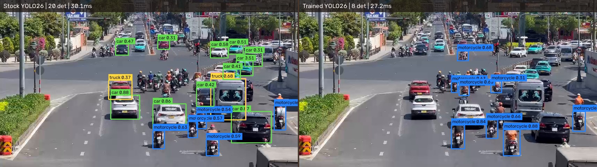
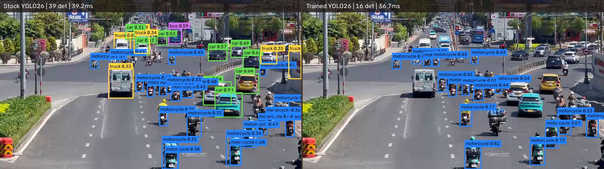
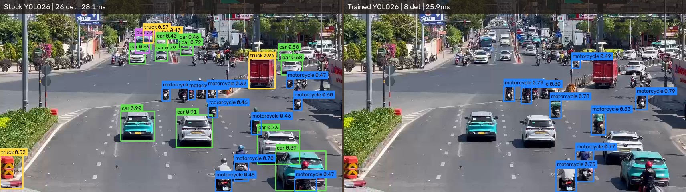
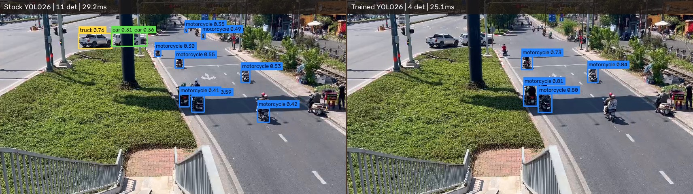
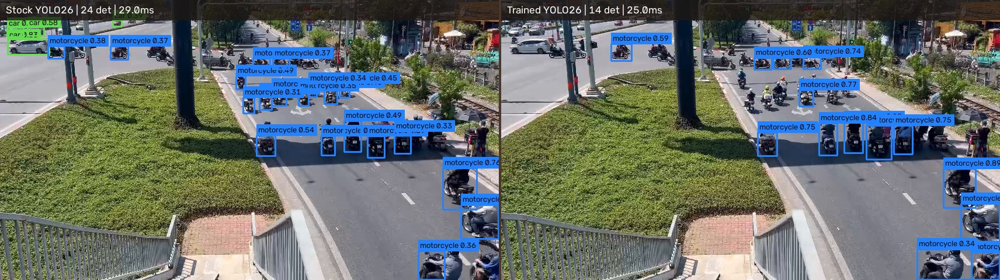
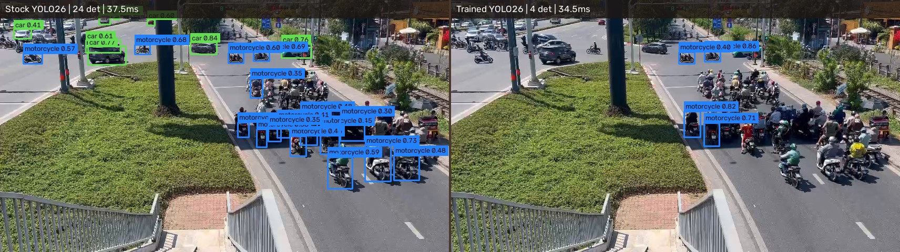
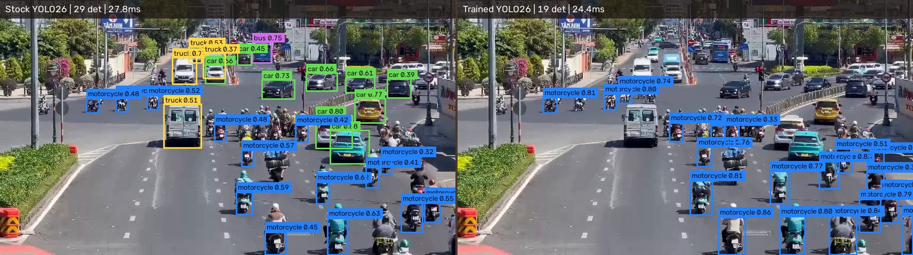
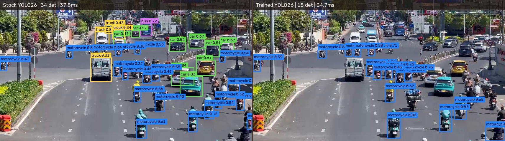
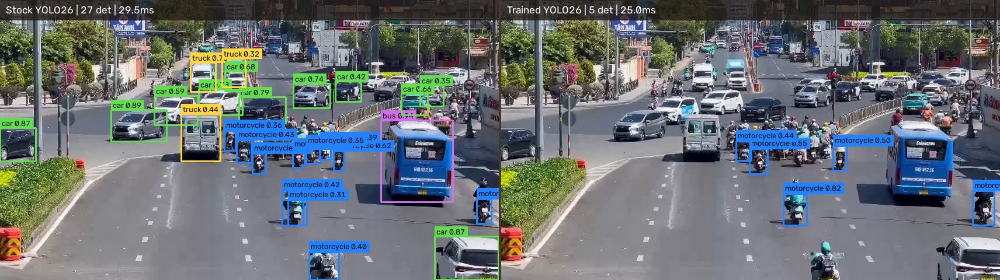

# VDAT Model Comparison Report: Stock YOLO26 vs Custom Trained YOLO26

- **Generated:** 2026-11-23 12:29:23
- **Hardware:** `CUDA: NVIDIA A100-SXM4-80GB (85.1 GB VRAM)` (`precision={'quantize': 16}`)
- **Stock Model:** `yolo26l.pt` (Vehicle filter: `True`)
- **Trained Model:** `/home/ubuntu/training.VDAT/weights/best.pt`
- **Trained Classes:** `{0: 'motorcycle'}`
- **Evaluation Settings:** `imgsz=864`, `conf=0.3`

## 1. Ground-Truth Dataset Benchmark (Class-Name-Aligned)

> Both models are evaluated on the exact same labeled images with canonical class-name alignment (e.g. COCO `motorcycle` ↔ dataset `motorcycle`) so Stock YOLO26 and Trained YOLO26 are compared apples-to-apples.

### Split: `test` (65 images, 174 ground-truth boxes)

| Metric | Stock YOLO26 | Trained YOLO26 | Δ (Trained − Stock) |
| :--- | ---: | ---: | ---: |
| **mAP@50** | 87.88% | **95.27%** | +7.39% |
| **mAP@50-95** | 56.76% | **79.91%** | +23.15% |
| **Precision (conf≥0.3)** | 76.06% | **81.28%** | +5.22% |
| **Recall (conf≥0.3)** | 93.10% | **94.83%** | +1.72% |
| **F1-Score** | 83.72% | **87.53%** | +3.81% |
| **True Positives (TP)** | 162 | 165 | +3 |
| **False Positives (FP)** | 51 | 38 | -13 |
| **False Negatives (FN / Missed)** | 12 | 9 | -3 |
| **Mean Matched IoU** | 0.825 | 0.891 | +0.066 |
| **Mean Confidence** | 0.650 | 0.859 | +0.209 |
| **Avg Inference Time** | 95.13 ms | 32.95 ms | -62.19 ms |

#### Per-Class Breakdown (`test`)

| Class | GT | Stock P / R / F1 / AP@50 | Trained P / R / F1 / AP@50 | AP@50 Δ |
| :--- | ---: | ---: | ---: | ---: |
| `motorcycle` | 174 | 76.1% / 93.1% / 83.7% / 87.9% | **81.3% / 94.8% / 87.5% / 95.3%** | +7.39% |

### Split: `val` (291 images, 884 ground-truth boxes)

| Metric | Stock YOLO26 | Trained YOLO26 | Δ (Trained − Stock) |
| :--- | ---: | ---: | ---: |
| **mAP@50** | 80.10% | **90.94%** | +10.84% |
| **mAP@50-95** | 49.90% | **72.25%** | +22.35% |
| **Precision (conf≥0.3)** | 69.86% | **79.40%** | +9.54% |
| **Recall (conf≥0.3)** | 79.19% | **89.82%** | +10.63% |
| **F1-Score** | 74.23% | **84.29%** | +10.06% |
| **True Positives (TP)** | 700 | 794 | +94 |
| **False Positives (FP)** | 302 | 206 | -96 |
| **False Negatives (FN / Missed)** | 184 | 90 | -94 |
| **Mean Matched IoU** | 0.810 | 0.871 | +0.061 |
| **Mean Confidence** | 0.628 | 0.820 | +0.192 |
| **Avg Inference Time** | 39.43 ms | 27.00 ms | -12.43 ms |

#### Per-Class Breakdown (`val`)

| Class | GT | Stock P / R / F1 / AP@50 | Trained P / R / F1 / AP@50 | AP@50 Δ |
| :--- | ---: | ---: | ---: | ---: |
| `motorcycle` | 884 | 69.9% / 79.2% / 74.2% / 80.1% | **79.4% / 89.8% / 84.3% / 90.9%** | +10.84% |

### Official Ultralytics `model.val()` Summary (Trained Model)

| Split | Precision | Recall | mAP@50 | mAP@50-95 |
| :--- | ---: | ---: | ---: | ---: |
| `test` | 92.92% | 93.10% | **96.56%** | **77.65%** |
| `val` | 85.73% | 87.70% | **93.02%** | **69.66%** |

## 2. Real Traffic Video Benchmark

### Overall Video Summary (3 videos, 180 sampled frames)

| Metric | Stock YOLO26 | Trained YOLO26 | Δ (Trained − Stock) |
| :--- | ---: | ---: | ---: |
| **Total Detections** | 4811 | **1110** | -3701 |
| **Avg Detections / Frame** | 26.73 | **6.17** | -20.56 |
| **High-Confidence Detections (≥0.50)** | 2792 | **917** | -1875 |
| **Small Objects (<32×32 px)** | 1700 | **309** | -1391 |
| **Mean Confidence** | 0.561 | **0.689** | +0.128 |
| **Avg Latency (ms/frame)** | 31.57 ms | **28.21 ms** | -3.36 ms |
| **Throughput (FPS)** | 31.7 FPS | **35.4 FPS** | +3.8 FPS |
| **Agreement (IoU≥0.50)** | Matched Both: **728** | Only Trained: **382** | Only Stock: **4083** |

### Video: `test_1.mp4` (854x480 @ 30.0 FPS, 60 sampled / 10852 total frames)

| Metric | Stock YOLO26 | Trained YOLO26 | Δ |
| :--- | ---: | ---: | ---: |
| Total Detections | 1738 | **352** | -1386 |
| Avg / Max per Frame | 28.97 / 39 | **5.87 / 16** | -23.10 |
| Confidence (Mean / Median / P95) | 0.573 / 0.557 / 0.879 | **0.693 / 0.768 / 0.853** | +0.120 |
| High-Conf Detections (≥0.50) | 1056 | **296** | -760 |
| Size Breakdown (Small / Med / Large) | 431 / 1165 / 142 | **99 / 253 / 0** | Small: -332 |
| Latency (Mean / P95) & FPS | 32.67 / 39.32 ms (30.6 FPS) | **29.42 / 36.11 ms (34.0 FPS)** | -3.25 ms |
| Box Agreement (IoU≥0.50) | Matched: 223 (IoU 0.673) | Only Trained: 129 | Only Stock: 1515 |

| Class (Canonical) | Stock Count | Trained Count | Δ |
| :--- | ---: | ---: | ---: |
| `bicycle` | 2 | **0** | -2 |
| `bus` | 99 | **0** | -99 |
| `car` | 879 | **0** | -879 |
| `motorcycle` | 543 | **352** | -191 |
| `truck` | 215 | **0** | -215 |

#### Saved Side-by-Side Snapshots

- **max_gain** (Frame `7908` — Stock: 20 vs Trained: 8): `frames/test_1_max_gain_f7908.jpg`
  
- **densest_traffic** (Frame `919` — Stock: 39 vs Trained: 16): `frames/test_1_densest_traffic_f919.jpg`
  
- **midpoint** (Frame `5517` — Stock: 26 vs Trained: 8): `frames/test_1_midpoint_f5517.jpg`
  

### Video: `test_2.mp4` (854x480 @ 30.0 FPS, 60 sampled / 8540 total frames)

| Metric | Stock YOLO26 | Trained YOLO26 | Δ |
| :--- | ---: | ---: | ---: |
| Total Detections | 1257 | **344** | -913 |
| Avg / Max per Frame | 20.95 / 26 | **5.73 / 14** | -15.22 |
| Confidence (Mean / Median / P95) | 0.528 / 0.496 / 0.816 | **0.687 / 0.737 / 0.880** | +0.159 |
| High-Conf Detections (≥0.50) | 620 | **285** | -335 |
| Size Breakdown (Small / Med / Large) | 737 / 516 / 4 | **102 / 242 / 0** | Small: -635 |
| Latency (Mean / P95) & FPS | 31.42 / 38.06 ms (31.8 FPS) | **28.07 / 34.54 ms (35.6 FPS)** | -3.35 ms |
| Box Agreement (IoU≥0.50) | Matched: 245 (IoU 0.731) | Only Trained: 99 | Only Stock: 1012 |

| Class (Canonical) | Stock Count | Trained Count | Δ |
| :--- | ---: | ---: | ---: |
| `bus` | 8 | **0** | -8 |
| `car` | 367 | **0** | -367 |
| `motorcycle` | 801 | **344** | -457 |
| `truck` | 81 | **0** | -81 |

#### Saved Side-by-Side Snapshots

- **max_gain** (Frame `6368` — Stock: 11 vs Trained: 4): `frames/test_2_max_gain_f6368.jpg`
  
- **densest_traffic** (Frame `7381` — Stock: 24 vs Trained: 14): `frames/test_2_densest_traffic_f7381.jpg`
  
- **midpoint** (Frame `4341` — Stock: 24 vs Trained: 4): `frames/test_2_midpoint_f4341.jpg`
  

### Video: `test_3.mp4` (854x480 @ 30.0 FPS, 60 sampled / 2052 total frames)

| Metric | Stock YOLO26 | Trained YOLO26 | Δ |
| :--- | ---: | ---: | ---: |
| Total Detections | 1816 | **414** | -1402 |
| Avg / Max per Frame | 30.27 / 40 | **6.90 / 19** | -23.37 |
| Confidence (Mean / Median / P95) | 0.581 / 0.568 / 0.882 | **0.686 / 0.761 / 0.856** | +0.105 |
| High-Conf Detections (≥0.50) | 1116 | **336** | -780 |
| Size Breakdown (Small / Med / Large) | 532 / 1187 / 97 | **108 / 306 / 0** | Small: -424 |
| Latency (Mean / P95) & FPS | 30.63 / 37.99 ms (32.7 FPS) | **27.15 / 34.67 ms (36.8 FPS)** | -3.48 ms |
| Box Agreement (IoU≥0.50) | Matched: 260 (IoU 0.669) | Only Trained: 154 | Only Stock: 1556 |

| Class (Canonical) | Stock Count | Trained Count | Δ |
| :--- | ---: | ---: | ---: |
| `bus` | 152 | **0** | -152 |
| `car` | 791 | **0** | -791 |
| `motorcycle` | 647 | **414** | -233 |
| `truck` | 226 | **0** | -226 |

#### Saved Side-by-Side Snapshots

- **max_gain** (Frame `730` — Stock: 29 vs Trained: 19): `frames/test_3_max_gain_f730.jpg`
  
- **densest_traffic** (Frame `695` — Stock: 34 vs Trained: 15): `frames/test_3_densest_traffic_f695.jpg`
  
- **midpoint** (Frame `1042` — Stock: 27 vs Trained: 5): `frames/test_3_midpoint_f1042.jpg`
  

