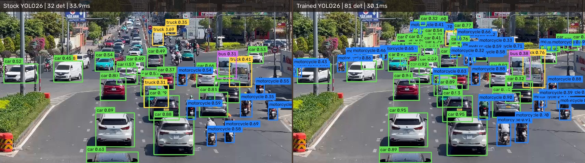
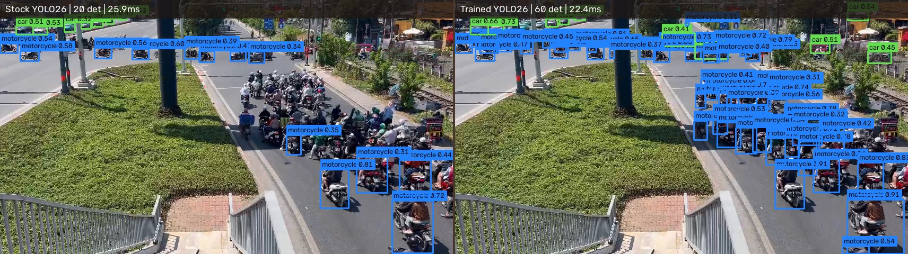
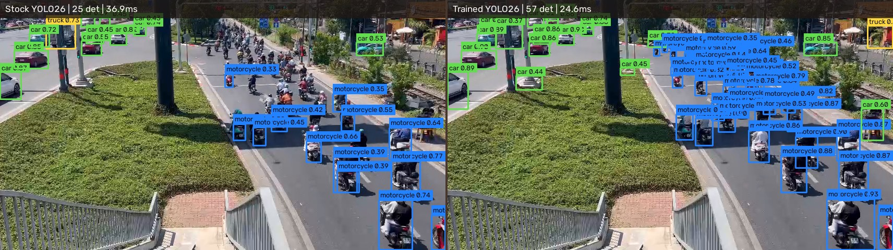
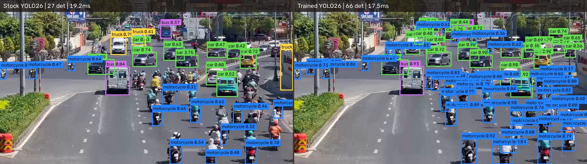
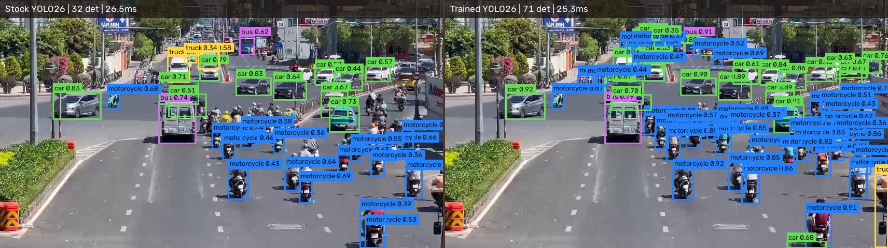

# VDAT Model Comparison Report: Stock YOLO26 vs Custom Trained YOLO26

- **Generated:** 2026-11-23 16:54:45
- **Hardware:** `CUDA: NVIDIA A100-SXM4-80GB (85.1 GB VRAM)` (`precision={'quantize': 16}`)
- **Stock Model:** `yolo26l.pt` (Vehicle filter: `True`)
- **Trained Model:** `/home/ubuntu/training.VDAT/weights/best.pt`
- **Trained Classes:** `{0: 'bicycle', 1: 'bus', 2: 'car', 3: 'motorcycle', 4: 'truck'}`
- **Evaluation Settings:** `imgsz=864`, `conf=0.3`

## 1. Ground-Truth Dataset Benchmark (Class-Name-Aligned)

> Both models are evaluated on the exact same labeled images with canonical class-name alignment (e.g. COCO `motorcycle` ↔ dataset `motorcycle`) so Stock YOLO26 and Trained YOLO26 are compared apples-to-apples.

### Split: `test` (64 images, 603 ground-truth boxes)

| Metric | Stock YOLO26 | Trained YOLO26 | Δ (Trained − Stock) |
| :--- | ---: | ---: | ---: |
| **mAP@50** | 66.11% | **89.37%** | +23.26% |
| **mAP@50-95** | 51.36% | **70.69%** | +19.33% |
| **Precision (conf≥0.3)** | 90.35% | **88.20%** | -2.15% |
| **Recall (conf≥0.3)** | 55.89% | **91.71%** | +35.82% |
| **F1-Score** | 69.06% | **89.92%** | +20.86% |
| **True Positives (TP)** | 337 | 553 | +216 |
| **False Positives (FP)** | 36 | 74 | +38 |
| **False Negatives (FN / Missed)** | 266 | 50 | -216 |
| **Mean Matched IoU** | 0.873 | 0.861 | -0.012 |
| **Mean Confidence** | 0.659 | 0.802 | +0.142 |
| **Avg Inference Time** | 55.28 ms | 17.46 ms | -37.82 ms |

#### Per-Class Breakdown (`test`)

| Class | GT | Stock P / R / F1 / AP@50 | Trained P / R / F1 / AP@50 | AP@50 Δ |
| :--- | ---: | ---: | ---: | ---: |
| `bicycle` | 12 | 83.3% / 41.7% / 55.6% / 63.1% | **90.0% / 75.0% / 81.8% / 86.3%** | +23.24% |
| `bus` | 21 | 66.7% / 38.1% / 48.5% / 54.3% | **85.7% / 85.7% / 85.7% / 89.6%** | +35.36% |
| `car` | 205 | 95.7% / 53.7% / 68.8% / 86.7% | **91.0% / 93.2% / 92.0% / 95.0%** | +8.24% |
| `motorcycle` | 340 | 93.6% / 60.0% / 73.1% / 82.4% | **87.5% / 92.6% / 90.0% / 94.8%** | +12.33% |
| `truck` | 25 | 45.5% / 40.0% / 42.6% / 44.1% | **76.9% / 80.0% / 78.4% / 81.2%** | +37.12% |

### Split: `val` (259 images, 2830 ground-truth boxes)

| Metric | Stock YOLO26 | Trained YOLO26 | Δ (Trained − Stock) |
| :--- | ---: | ---: | ---: |
| **mAP@50** | 71.07% | **83.10%** | +12.03% |
| **mAP@50-95** | 54.59% | **66.13%** | +11.54% |
| **Precision (conf≥0.3)** | 88.13% | **86.31%** | -1.82% |
| **Recall (conf≥0.3)** | 54.03% | **88.45%** | +34.42% |
| **F1-Score** | 66.99% | **87.36%** | +20.38% |
| **True Positives (TP)** | 1529 | 2503 | +974 |
| **False Positives (FP)** | 206 | 397 | +191 |
| **False Negatives (FN / Missed)** | 1301 | 327 | -974 |
| **Mean Matched IoU** | 0.878 | 0.865 | -0.013 |
| **Mean Confidence** | 0.661 | 0.803 | +0.142 |
| **Avg Inference Time** | 33.39 ms | 20.38 ms | -13.00 ms |

#### Per-Class Breakdown (`val`)

| Class | GT | Stock P / R / F1 / AP@50 | Trained P / R / F1 / AP@50 | AP@50 Δ |
| :--- | ---: | ---: | ---: | ---: |
| `bicycle` | 53 | 65.2% / 56.6% / 60.6% / 58.5% | **65.2% / 56.6% / 60.6% / 67.2%** | +8.77% |
| `bus` | 67 | 79.6% / 64.2% / 71.1% / 78.1% | **70.2% / 88.1% / 78.1% / 84.3%** | +6.21% |
| `car` | 952 | 92.6% / 56.9% / 70.5% / 81.8% | **89.6% / 85.9% / 87.7% / 91.7%** | +9.87% |
| `motorcycle` | 1619 | 91.3% / 51.7% / 66.0% / 77.5% | **86.7% / 92.4% / 89.4% / 93.7%** | +16.17% |
| `truck` | 139 | 57.9% / 55.4% / 56.6% / 59.5% | **76.3% / 71.9% / 74.1% / 78.6%** | +19.12% |

### Official Ultralytics `model.val()` Summary (Trained Model)

| Split | Precision | Recall | mAP@50 | mAP@50-95 |
| :--- | ---: | ---: | ---: | ---: |
| `test` | 85.69% | 83.93% | **89.38%** | **68.67%** |
| `val` | 82.51% | 77.56% | **82.67%** | **63.46%** |

## 2. Real Traffic Video Benchmark

### Overall Video Summary (3 videos, 180 sampled frames)

| Metric | Stock YOLO26 | Trained YOLO26 | Δ (Trained − Stock) |
| :--- | ---: | ---: | ---: |
| **Total Detections** | 4811 | **9666** | +4855 |
| **Avg Detections / Frame** | 26.73 | **53.70** | +26.97 |
| **High-Confidence Detections (≥0.50)** | 2792 | **8328** | +5536 |
| **Small Objects (<32×32 px)** | 1700 | **5246** | +3546 |
| **Mean Confidence** | 0.561 | **0.738** | +0.177 |
| **Avg Latency (ms/frame)** | 23.59 ms | **20.52 ms** | -3.07 ms |
| **Throughput (FPS)** | 42.4 FPS | **48.7 FPS** | +6.3 FPS |
| **Agreement (IoU≥0.50)** | Matched Both: **4243** | Only Trained: **5423** | Only Stock: **568** |

### Video: `test_1.mp4` (854x480 @ 30.0 FPS, 60 sampled / 10852 total frames)

| Metric | Stock YOLO26 | Trained YOLO26 | Δ |
| :--- | ---: | ---: | ---: |
| Total Detections | 1738 | **3618** | +1880 |
| Avg / Max per Frame | 28.97 / 39 | **60.30 / 81** | +31.33 |
| Confidence (Mean / Median / P95) | 0.573 / 0.557 / 0.879 | **0.756 / 0.826 / 0.939** | +0.184 |
| High-Conf Detections (≥0.50) | 1056 | **3166** | +2110 |
| Size Breakdown (Small / Med / Large) | 431 / 1165 / 142 | **1780 / 1697 / 141** | Small: +1349 |
| Latency (Mean / P95) & FPS | 23.98 / 33.70 ms (41.7 FPS) | **20.26 / 26.50 ms (49.4 FPS)** | -3.72 ms |
| Box Agreement (IoU≥0.50) | Matched: 1561 (IoU 0.864) | Only Trained: 2057 | Only Stock: 177 |

| Class (Canonical) | Stock Count | Trained Count | Δ |
| :--- | ---: | ---: | ---: |
| `bicycle` | 2 | **7** | +5 |
| `bus` | 99 | **119** | +20 |
| `car` | 879 | **1865** | +986 |
| `motorcycle` | 543 | **1547** | +1004 |
| `truck` | 215 | **80** | -135 |

#### Saved Side-by-Side Snapshots

- **max_gain** (Frame `0` — Stock: 32 vs Trained: 81): `frames/test_1_max_gain_f0.jpg`
  
- **midpoint** (Frame `5517` — Stock: 26 vs Trained: 49): `frames/test_1_midpoint_f5517.jpg`
  

### Video: `test_2.mp4` (854x480 @ 30.0 FPS, 60 sampled / 8540 total frames)

| Metric | Stock YOLO26 | Trained YOLO26 | Δ |
| :--- | ---: | ---: | ---: |
| Total Detections | 1257 | **2568** | +1311 |
| Avg / Max per Frame | 20.95 / 26 | **42.80 / 60** | +21.85 |
| Confidence (Mean / Median / P95) | 0.528 / 0.496 / 0.816 | **0.703 / 0.768 / 0.897** | +0.175 |
| High-Conf Detections (≥0.50) | 620 | **2100** | +1480 |
| Size Breakdown (Small / Med / Large) | 737 / 516 / 4 | **1700 / 860 / 8** | Small: +963 |
| Latency (Mean / P95) & FPS | 22.80 / 32.08 ms (43.9 FPS) | **20.08 / 25.18 ms (49.8 FPS)** | -2.72 ms |
| Box Agreement (IoU≥0.50) | Matched: 1036 (IoU 0.808) | Only Trained: 1532 | Only Stock: 221 |

| Class (Canonical) | Stock Count | Trained Count | Δ |
| :--- | ---: | ---: | ---: |
| `bicycle` | 0 | **10** | +10 |
| `bus` | 8 | **13** | +5 |
| `car` | 367 | **631** | +264 |
| `motorcycle` | 801 | **1863** | +1062 |
| `truck` | 81 | **51** | -30 |

#### Saved Side-by-Side Snapshots

- **max_gain** (Frame `1157` — Stock: 20 vs Trained: 60): `frames/test_2_max_gain_f1157.jpg`
  
- **densest_traffic** (Frame `8104` — Stock: 25 vs Trained: 57): `frames/test_2_densest_traffic_f8104.jpg`
  
- **midpoint** (Frame `4341` — Stock: 24 vs Trained: 51): `frames/test_2_midpoint_f4341.jpg`
  

### Video: `test_3.mp4` (854x480 @ 30.0 FPS, 60 sampled / 2052 total frames)

| Metric | Stock YOLO26 | Trained YOLO26 | Δ |
| :--- | ---: | ---: | ---: |
| Total Detections | 1816 | **3480** | +1664 |
| Avg / Max per Frame | 30.27 / 40 | **58.00 / 71** | +27.73 |
| Confidence (Mean / Median / P95) | 0.581 / 0.568 / 0.882 | **0.754 / 0.821 / 0.934** | +0.173 |
| High-Conf Detections (≥0.50) | 1116 | **3062** | +1946 |
| Size Breakdown (Small / Med / Large) | 532 / 1187 / 97 | **1766 / 1611 / 103** | Small: +1234 |
| Latency (Mean / P95) & FPS | 23.98 / 29.59 ms (41.7 FPS) | **21.22 / 26.63 ms (47.1 FPS)** | -2.76 ms |
| Box Agreement (IoU≥0.50) | Matched: 1646 (IoU 0.846) | Only Trained: 1834 | Only Stock: 170 |

| Class (Canonical) | Stock Count | Trained Count | Δ |
| :--- | ---: | ---: | ---: |
| `bicycle` | 0 | **1** | +1 |
| `bus` | 152 | **169** | +17 |
| `car` | 791 | **1570** | +779 |
| `motorcycle` | 647 | **1689** | +1042 |
| `truck` | 226 | **51** | -175 |

#### Saved Side-by-Side Snapshots

- **max_gain** (Frame `799` — Stock: 27 vs Trained: 66): `frames/test_3_max_gain_f799.jpg`
  
- **densest_traffic** (Frame `869` — Stock: 32 vs Trained: 71): `frames/test_3_densest_traffic_f869.jpg`
  
- **midpoint** (Frame `1042` — Stock: 27 vs Trained: 56): `frames/test_3_midpoint_f1042.jpg`
  

